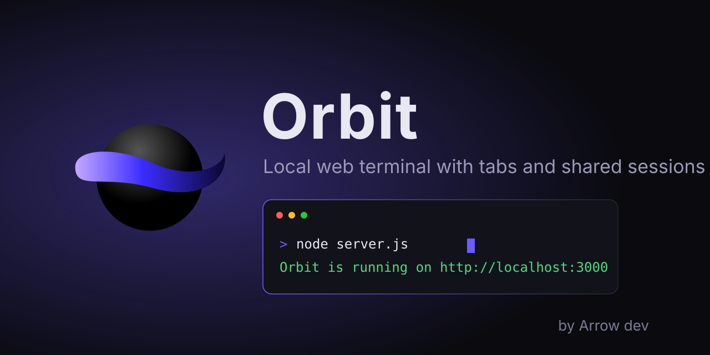

<div align="center">



# Orbit Terminal

ترمینال وب محلی با تب، انیمیشن روان و نشست‌های قابل اشتراک

[English](README.eng.md) | فارسی

</div>

## معرفی

Orbit یک ترمینال تحت وب است که روی سیستم خودتان اجرا می‌شود. هیچ سرویس بیرونی و هیچ وابستگی (dependency) لازم ندارد. فقط Node.js کافی است.

## امکانات

- شل واقعی (bash/sh روی لینوکس، مک و ترمودکس؛ PowerShell روی ویندوز)
- تب‌های چندگانه با انیمیشن انتقال
- نشست قابل اشتراک: لینک را به شبکه‌ی خودتان بدهید تا همزمان در یک ترمینال کار کنید
- مدیریت فایل: مرور فایل‌های دستگاه، پیش‌نمایش متن، دانلود، آپلود و ورود به پوشه در ترمینال
- فونت وزیرمتن و JetBrains Mono به‌صورت محلی (بدون اینترنت)
- تنظیمات ساده: تغییر زبان رابط (فارسی / English)
- بدون وابستگی و بدون نیاز به نصب بسته

## پیش‌نیاز

Node.js نسخه ۱۸ یا بالاتر. بررسی نسخه:

```
node -v
```

## نصب و اجرا

```
git clone https://github.com/rV9Cy/Orbit-Terminal.git
cd Orbit-Terminal
node server.js
```

سپس در مرورگر آدرس `http://localhost:3000` را باز کنید.

### اجرا در ترمینال‌های مختلف

**Termux (اندروید)**

```
pkg update && pkg upgrade
pkg install nodejs git
git clone https://github.com/rV9Cy/Orbit-Terminal.git
cd Orbit-Terminal
node server.js
```

مرورگر گوشی را باز کنید و به `http://localhost:3000` بروید.

**لینوکس (Ubuntu / Debian)**

```
sudo apt update
sudo apt install nodejs git
cd Orbit-Terminal
node server.js
```

اگر نسخه‌ی Node قدیمی بود، از nvm یا NodeSource استفاده کنید.

**مک (macOS)**

```
brew install node git
cd Orbit-Terminal
node server.js
```

**ویندوز - PowerShell**

```
winget install OpenJS.NodeJS.LTS
cd Orbit-Terminal
node server.js
```

**ویندوز - CMD**

```
cd Orbit-Terminal
node server.js
```

**ویندوز - Git Bash یا WSL**

مانند لینوکس اجرا کنید:

```
cd Orbit-Terminal
node server.js
```

### تغییر پورت و دسترسی از شبکه

به‌طور پیش‌فرض فقط روی `127.0.0.1` گوش می‌دهد. برای تغییر پورت یا باز کردن روی شبکه:

| محیط | دستور |
|---|---|
| لینوکس / مک / Termux / Git Bash | `PORT=4000 HOST=0.0.0.0 node server.js` |
| PowerShell | `$env:PORT=4000; $env:HOST="0.0.0.0"; node server.js` |
| CMD | `set PORT=4000 && set HOST=0.0.0.0 && node server.js` |

### فایل‌های دستگاه

ترمینال از پوشه‌ی خانه‌ی شما شروع می‌شود (پرامپت `local@orbit ~ >`) و دستور `ls` فایل‌های واقعی دستگاه را نشان می‌دهد. روی Termux برای دسترسی به حافظه‌ی گوشی یک بار این دستور را بزنید و اجازه بدهید:

```
termux-setup-storage
```

بعد با `cd ~/storage/shared` به فایل‌های گوشی (Download، DCIM و غیره) می‌رسید. روی ویندوز، لینوکس و مک هم با `cd` به هر مسیری که کاربر فعلی دسترسی دارد بروید.

## لغو دستور در حال اجرا

- صفحه‌کلید: `Ctrl+C` را بزنید (اگر متنی انتخاب شده باشد فقط کپی می‌شود).
- گوشی و صفحه‌ی لمسی: وقتی دستوری در حال اجراست، کنار کادر تایپ دکمه‌ی قرمز `Ctrl+C` ظاهر می‌شود.
- با لغو، برنامه‌ی در حال اجرا و تمام زیرمجموعه‌هایش بسته می‌شوند و یک شل تازه در همان پوشه‌ی قبلی باز می‌شود.
- پاک کردن صفحه: `clear` یا `Ctrl+L`.

## شل‌های پشتیبانی‌شده

شلی که داخل Orbit اجرا می‌شود به سیستم‌عامل بستگی دارد، نه به ترمینالی که سرور را با آن روشن کرده‌اید:

| سیستم | شل پیش‌فرض |
|---|---|
| لینوکس، مک، Termux | شل کاربر (`$SHELL`) مثل bash، zsh، fish یا sh |
| ویندوز | PowerShell |

دستورهای CMD مثل `dir` و `cd` در PowerShell هم کار می‌کنند. برای بقیه از `cmd /c دستور` استفاده کنید.

برای انتخاب شل دلخواه از متغیر `ORBIT_SHELL` استفاده کنید:

| محیط | دستور |
|---|---|
| لینوکس / مک / Termux / Git Bash | `ORBIT_SHELL=zsh node server.js` |
| PowerShell | `$env:ORBIT_SHELL="pwsh"; node server.js` |
| CMD | `set ORBIT_SHELL=pwsh && node server.js` |

نوع شل از روی اسمش تشخیص داده می‌شود: اگر اسمش `pwsh` یا `powershell` باشد از روش PowerShell و در غیر این صورت از روش POSIX (مثل bash) استفاده می‌شود. شل‌های غیر از این دو خانواده، مثل CMD خالص، تست نشده‌اند.

## محدودیت‌ها

Orbit ترمینال واقعی (PTY) نیست و شل را با pipe اجرا می‌کند. دستورهای معمولی مثل `ls`، `git`، `npm`، `node` و `python script.py` کار می‌کنند، ولی این‌ها درست کار نمی‌کنند:

- برنامه‌های تمام‌صفحه مثل `vim`، `nano` و `htop`
- برنامه‌هایی که سؤال تعاملی می‌پرسند، مثل رمز `ssh` یا اجرای `python` بدون فایل
- رنگ خروجی (کدهای رنگی حذف می‌شوند)

## هشدار امنیتی

Orbit یک شل واقعی در اختیار کاربر قرار می‌دهد. اگر `HOST=0.0.0.0` را بزنید، هر کسی که به آن پورت دسترسی داشته باشد می‌تواند روی دستگاه شما دستور اجرا کند. این کار را فقط در شبکه‌ی قابل اعتماد انجام دهید.

## ساختار پروژه

```
orbit-terminal/
  server.js        سرور بدون وابستگی
  public/          رابط کاربری و فونت‌ها
  assets/          پوستر
```

## حمایت و ارتباط

- سازنده: Arrow dev
- حمایت مالی: https://donate.sudoshz.ir/u/spidey_team
- کانال تلگرام: https://t.me/ArrowDeveloper

## مجوز

MIT
